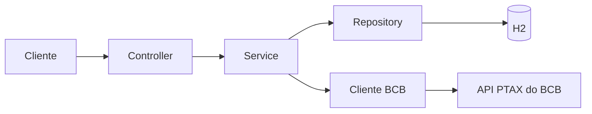
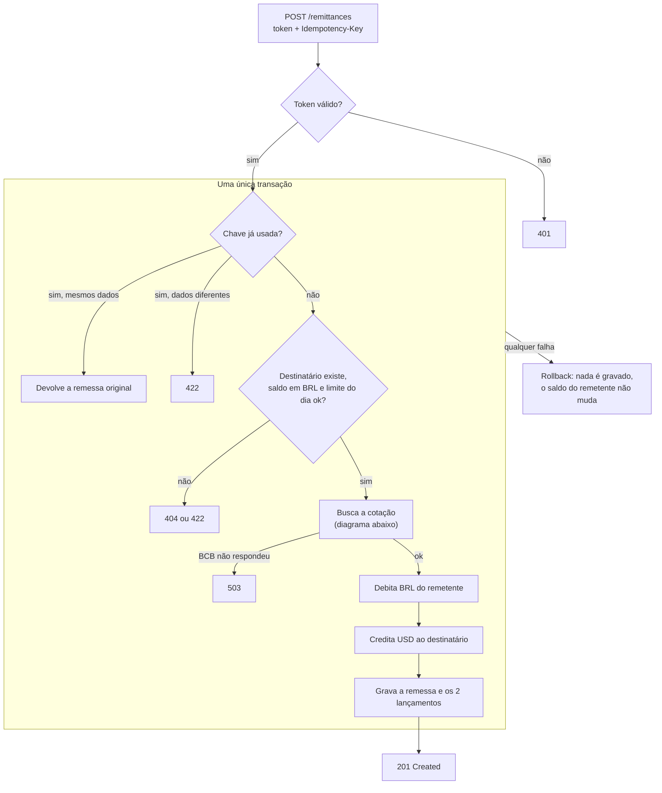
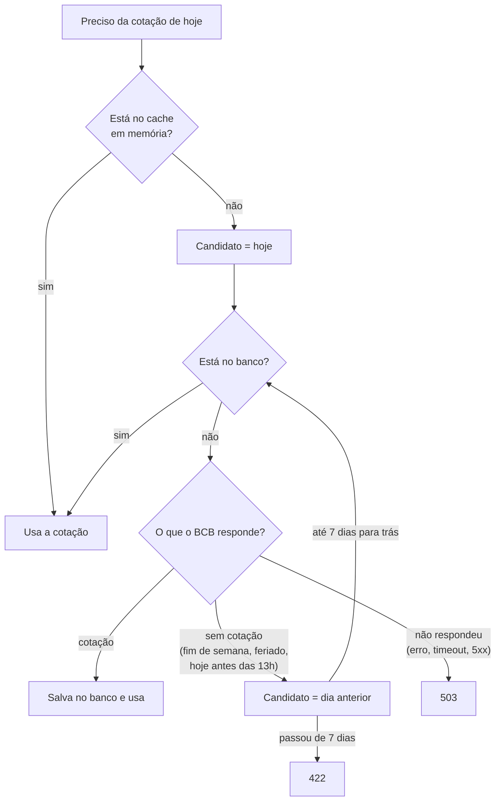
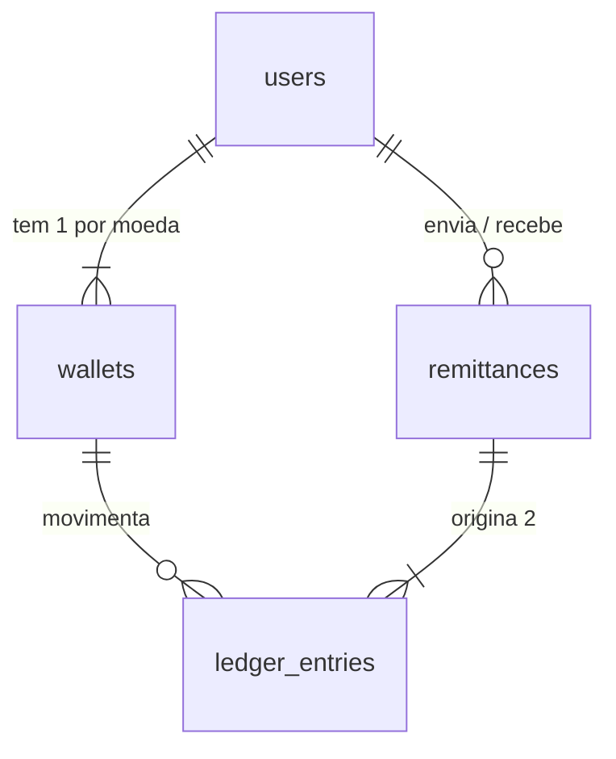

# Cross Border API

Serviço de remessa entre usuários PF e PJ: converte Real em Dólar com a cotação oficial do Banco Central e transfere o valor convertido, tudo em uma única transação.

**Java 21 · Spring Boot 4 · Maven · H2 em memória**

## Índice

1. [Como compilar e executar](#1-como-compilar-e-executar)
2. [Como executar os testes](#2-como-executar-os-testes)
3. [Testando em 2 minutos](#3-testando-em-2-minutos)
4. [Como o sistema funciona](#4-como-o-sistema-funciona)
5. [Endpoints](#5-endpoints)
6. [Requisitos e como foram atendidos](#6-requisitos-e-como-foram-atendidos)
7. [Decisões de design](#7-decisões-de-design)
8. [Modelo de dados](#8-modelo-de-dados)
9. [Docker, Kubernetes e CI/CD](#9-docker-kubernetes-e-cicd)
10. [Limitações e melhorias](#10-limitações-e-melhorias)

---

## 1. Como compilar e executar

Requisito: **JDK 21** (`java -version`). No Windows, use `mvnw.cmd`.

```bash
./mvnw spring-boot:run
```

Ou gerando o jar:

```bash
./mvnw clean package          # compila e roda os testes (-DskipTests para pular)
java -jar target/crossborder-api-0.0.1-SNAPSHOT.jar
```

Ou com Docker (não precisa de JDK):

```bash
docker build -t cross-border-api:local .
docker run --rm -p 8080:8080 cross-border-api:local
```

| O quê | Onde |
|---|---|
| API | http://localhost:8080 |
| Swagger UI | http://localhost:8080/swagger-ui.html |
| Health check | http://localhost:8080/actuator/health |
| Console do H2 | http://localhost:8080/h2-console (JDBC URL `jdbc:h2:mem:crossborderdb`, usuário `sa`, senha vazia) |

> Fora do Docker, a aplicação também abre o servidor TCP do H2 na porta **9092**, para consultar o banco pelo terminal. Se a porta estiver ocupada, desligue com `--app.h2-tcp-server.enabled=false` (`./mvnw spring-boot:run -Dspring-boot.run.arguments=--app.h2-tcp-server.enabled=false`).

## 2. Como executar os testes

```bash
./mvnw verify      # roda os testes e gera o relatório de cobertura (JaCoCo)
./mvnw test        # só os testes
```

Relatório em `target/site/jacoco/index.html`: cerca de **97% das linhas** e **92% dos branches** (mais de 180 testes). Nenhum teste chama o BCB de verdade.

| Tipo | O que cobre |
|---|---|
| **Integração ponta a ponta** (MockMvc + H2 real, só o BCB simulado) | Os 12 endpoints; sucesso e erros (`400`, `404`, `409`, `422`); limites PF/PJ; idempotência; fallback de cotação; **rollback** |
| **Unitários** (Mockito) | Cadastro, depósito, remessa (validações, conversão, débito/crédito, ledger, limite, idempotência), cotação (cache, fallback, erros), extrato |
| **Strategy do limite diário** | Política de PF e de PJ |
| **Cliente do BCB** (`MockRestServiceServer`) | Resposta normal, dia sem cotação, erro 500, resposta malformada e **timeout** contra um servidor que nunca responde |
| **Banco real (H2)** | Lock otimista das carteiras (duas atualizações concorrentes); as entidades conferidas contra o `schema.sql` |
| **Erros** | Mapeamento das exceções para os códigos HTTP, inclusive rota inexistente, método e `Content-Type` não suportados (`404`, `405`, `415`) e erro inesperado (`500`, sem vazar detalhes) |

Dois detalhes de como os testes foram feitos:
- **Rollback:** o teste força uma falha *depois* do débito e do crédito (ao gravar a remessa e o lançamento) e confere que o saldo volta, que nada fica gravado e que a mesma chave pode ser reenviada.
- **Tempo:** as regras que dependem do relógio (virada do dia no limite diário, data futura, expiração do token) usam um `Clock` injetado, então os testes fixam a hora, inclusive a meia-noite de Brasília.

---

## 3. Testando em 2 minutos

Com a aplicação no ar, este roteiro cadastra dois usuários, faz uma remessa e consulta o resultado. Pelo Swagger é o mesmo caminho: depois do login, cole o `accessToken` no botão **Authorize**.

```bash
B=http://localhost:8080; H='Content-Type: application/json'

# 1. Cadastra Ana (PF, id 1) e Bruno (PJ, id 2). Cada um já ganha carteira BRL e USD com saldo zero.
curl -s -X POST $B/users -H "$H" -d '{"fullName":"Ana Souza","email":"ana@email.com","password":"senha123","userType":"PF","document":"123.456.789-09"}'
curl -s -X POST $B/users -H "$H" -d '{"fullName":"Bruno Ltda","email":"bruno@email.com","password":"senha123","userType":"PJ","document":"12.345.678/0001-95"}'

# 2. Login da Ana: devolve o token JWT
TOKEN=$(curl -s -X POST $B/auth/login -H "$H" -d '{"email":"ana@email.com","password":"senha123"}' | sed -E 's/.*"accessToken":"([^"]+)".*/\1/')

# 3. Deposita R$ 1.000 na carteira da Ana (endpoint auxiliar de teste)
curl -s -X POST $B/users/1/wallets/deposit -H "$H" -H "Authorization: Bearer $TOKEN" -d '{"currency":"BRL","amount":1000}'

# 4. Ana envia R$ 500 para o Bruno (o remetente é sempre o dono do token)
curl -s -X POST $B/remittances -H "$H" -H "Authorization: Bearer $TOKEN" -H "Idempotency-Key: remessa-001" -d '{"receiverId":2,"amountBrl":500}'

# 5. Confere: saldos, extrato e a cotação usada
curl -s $B/users/1/wallets -H "Authorization: Bearer $TOKEN"
curl -s $B/users/1/ledger-entries -H "Authorization: Bearer $TOKEN"
curl -s $B/exchange-rates/$(date +%F)
```

Resposta da remessa (o valor em dólar depende da cotação do dia):

```json
{"id":1,"senderId":1,"receiverId":2,"amountBrl":500.00,"amountUsd":96.96,"exchangeRate":5.15690,
 "quoteDate":"2026-09-18","direction":"BRL_TO_USD","status":"COMPLETED","createdAt":"..."}
```

Pontos para experimentar:
- **Idempotência:** repita o passo 4 com a mesma `Idempotency-Key` e a mesma remessa volta, sem debitar de novo. Mude o valor e o resultado é `422`. Use uma chave **nova** a cada remessa.
- **Fim de semana:** rode num sábado ou domingo. O `quoteDate` da resposta mostra a sexta, o dia da cotação realmente usada.
- **Limite diário:** PF até R$ 10 mil por dia, PJ até R$ 50 mil. Acima disso, `422`.

---

## 4. Como o sistema funciona

### Camadas



O `Controller` só recebe e valida a requisição; as regras ficam no `Service`. Só o `Cliente BCB` conhece a API externa e só o `Repository` fala com o banco.

### Caminho de uma remessa



Só o `401` é resolvido antes, no filtro de segurança. Todo o resto, inclusive a busca da cotação, roda dentro da mesma `@Transactional`: um erro em qualquer passo desfaz tudo.

### Caminho da cotação



Só a cotação do **dia exato** vai para o cache em memória. Uma cotação de fallback não entra, porque ficaria desatualizada quando a do dia for publicada.

---

## 5. Endpoints

| Método | Rota | Para quê | Acesso |
|---|---|---|---|
| `POST` | `/auth/login` | Troca e-mail e senha por um token JWT (HS256, expira em 1 h) | público |
| `POST` | `/users` | Cadastra usuário PF ou PJ e cria as carteiras BRL e USD | público |
| `GET` | `/exchange-rates/{data}` | Cotação aplicada em uma data (`AAAA-MM-DD`) e a data real dela | público |
| `POST` | `/remittances` | **Cria a remessa.** Exige `Idempotency-Key`; o remetente é o usuário do token | token |
| `GET` | `/remittances/{id}` | Busca uma remessa | token; só quem enviou ou recebeu |
| `GET` | `/remittances/{id}/ledger-entries` | Os 2 lançamentos (débito e crédito) da remessa | token; só quem enviou ou recebeu |
| `GET` | `/users` | Lista todos os usuários (deixado assim de propósito, para facilitar os testes) | token |
| `GET` | `/users/{id}` | Busca um usuário | token; só o próprio |
| `GET` | `/users/{id}/wallets` | Saldos em BRL e USD | token; só o próprio |
| `POST` | `/users/{id}/wallets/deposit` | Deposita saldo (auxiliar de teste) | token; só o próprio |
| `GET` | `/users/{id}/remittances` | Remessas enviadas; `?remittanceId=` filtra uma | token; só o próprio |
| `GET` | `/users/{id}/ledger-entries` | Extrato; `?currency=BRL` filtra a moeda | token; só o próprio |

Também são públicos o Swagger, o health e o console do H2. As demais rotas exigem `Authorization: Bearer <token>`.

**Regras de acesso:** em `/users/{id}/...` o `{id}` precisa ser o do token, senão `403`. Em `POST /remittances` não existe `senderId` no body. Quem não participa de uma remessa recebe `404`, como se ela não existisse.

**Erros** seguem sempre o mesmo formato: `timestamp`, `status`, `error`, `message`, `fieldErrors`.

| Código | Quando |
|---|---|
| `400` | Campo inválido ou ausente (documento com tamanho errado para o tipo; valor com mais de 2 casas ou menor que 0,01), header ausente, id ou data em formato errado |
| `401` | Sem token, token inválido ou expirado, ou e-mail/senha incorretos |
| `403` | `/users/{id}/...` de outro usuário |
| `404` | Usuário ou remessa inexistente (ou remessa de que o usuário não participa) |
| `409` | E-mail ou documento já cadastrado, carteira alterada por outra operação, chave de idempotência em uso |
| `422` | Saldo insuficiente, limite diário, remessa para si mesmo, valor que converte para US$ 0,00, cotação indisponível, chave reutilizada com outros dados |
| `503` | API do BCB fora do ar e sem a cotação do dia em cache; é só tentar de novo |

---

## 6. Requisitos e como foram atendidos

**Diferenciais do desafio:** testes de integração (seção 2) · cache das cotações com Caffeine (seção 7) · Docker, Kubernetes e CI (seção 9) · melhorias possíveis (seção 10).

| Requisito | Como foi atendido |
|---|---|
| Remessa = conversão + transferência, revertida em qualquer inconsistência | `RemittanceService` em **uma única `@Transactional`**: débito, crédito, remessa e lançamentos são gravados juntos, ou nada é gravado |
| Cotação do BCB, campo `cotacaoCompra` | `BcbExchangeRateClient` (API PTAX). A remessa guarda a cotação e o **dia a que ela pertence** (`quoteDate`): numa remessa de domingo, `exchangeRate` é a de sexta e `quoteDate` mostra isso |
| Fim de semana: usar a última cotação | Fallback dia a dia, até 7 dias para trás (um fim de semana precisa de até 3; feriados como o Carnaval, uns 5). Vale quando o BCB **responde** que não há cotação. Se ele **não responde**, é outro caso: veja "Cliente do BCB" na seção 7 |
| Validar saldo antes da remessa | `422 Saldo insuficiente` |
| Usuário com nome, e-mail, senha, CPF (PF) ou CNPJ (PJ); e-mail e documento únicos | Constraints `UNIQUE` no banco; duplicidade → `409`; senha com BCrypt. O e-mail é guardado em minúsculas e o documento só com dígitos (`123.456.789-09` e `12345678909` são o mesmo usuário); PF precisa de 11 dígitos e PJ de 14 |
| Limite diário: PF R$ 10 mil, PJ R$ 50 mil | **Strategy**: `PfDailyLimitPolicy` e `PjDailyLimitPolicy` implementam `DailyLimitPolicy`. Soma o BRL já enviado no dia; passou do limite → `422` |
| Sem restrição entre PF e PJ | Qualquer combinação é aceita |
| Carteira em Real e em Dólar | Criadas automaticamente, com saldo zero, no cadastro |
| Banco em memória | H2. O schema é escrito à mão em `schema.sql` e o Hibernate só **valida** (`ddl-auto=validate`) |

**Interpretações onde o enunciado é aberto:**
- **Remessa para o próprio usuário é bloqueada** (`422`): "remessa entre eles" pressupõe duas partes.
- **O limite diário** conta o BRL enviado pelo remetente no dia corrente do servidor (a imagem Docker usa o fuso `America/Sao_Paulo`).
- **Valores em dinheiro** têm no máximo 2 casas e mínimo de R$ 0,01 (`400`). Se na cotação do dia o valor converte para US$ 0,00, a remessa é recusada com `422`, em vez de não creditar nada.
- **Remessa que falha não é gravada.** Só o erro HTTP volta.

---

## 7. Decisões de design

- **Idempotência.** `POST /remittances` exige `Idempotency-Key`, com `UNIQUE (sender_id, idempotency_key)` no banco. Repetir a chamada devolve a remessa original; a mesma chave com dados diferentes é recusada; duas requisições simultâneas com a mesma chave, uma leva `409`. Medido localmente: sem a chave, dois cliques com 50 ms de intervalo debitavam **duas vezes** (12 de 12 tentativas); com ela, uma.
- **Lock otimista** (`@Version`) nas carteiras. Duas remessas concorrentes na mesma carteira: uma leva `409` em vez de sobrescrever o saldo.
- **Ledger imutável.** Cada remessa grava um `DEBIT` em BRL na carteira de quem envia e um `CREDIT` em USD na de quem recebe. Só leitura na API.
- **Cache das cotações em duas camadas.** (1) Spring Cache com **Caffeine** (`@Cacheable` no `getQuote`), em memória, TTL de 1 dia e no máximo 500 datas: a segunda remessa do dia não toca o banco nem o BCB. (2) A tabela `exchange_rates`, uma cotação por dia, que guarda o **histórico** e é de onde sai o fallback "última cotação obtida". Erros não são cacheados.
- **Cliente do BCB.** Timeouts de 3 s (conexão) e 5 s (leitura). O sistema distingue *"o BCB respondeu que não há cotação"* (fim de semana ou feriado: usa a última) de *"o BCB não respondeu"* (erro, timeout, 5xx ou resposta fora do formato). No segundo caso falha direto com `503`, sem debitar nada: sem resposta não dá para saber se o dia é útil, e converter dinheiro com uma cotação antiga seria pior que pedir para tentar de novo.
- **Autenticação JWT** (Spring Security, sem sessão no servidor). Não foi pedida no enunciado; foi adicionada para que o remetente seja sempre o dono do token. O segredo vem de `app.security.jwt.secret`, e os erros `401` usam o mesmo formato de erro da API.

---

## 8. Modelo de dados



| Tabela | Papel |
|---|---|
| `users` | Dados do usuário; `email` e `document` únicos; `user_type` PF/PJ |
| `wallets` | **Uma linha por usuário e moeda** (`UNIQUE user_id, currency`); `balance` e `version` (lock otimista) |
| `remittances` | Valores em BRL e USD, cotação usada, o dia dela (`quote_date`) e a `idempotency_key` |
| `ledger_entries` | Lançamentos imutáveis: carteira, moeda, `DEBIT`/`CREDIT`, valor e a remessa de origem (`reference_type`/`reference_id`) |
| `exchange_rates` | Histórico das cotações do BCB, uma por dia (`quote_date` único) |

---

## 9. Docker, Kubernetes e CI/CD

**Docker.** `Dockerfile` multi-stage (build com JDK 21, execução com JRE 21). O container roda como usuário **não-root**, com `TZ=America/Sao_Paulo` e sem o servidor TCP do H2.

**Kubernetes.** Manifestos em `k8s/` (Kustomize): `Deployment`, `Service` e `ConfigMap`. O segredo do JWT vem de um `Secret` que **não é versionado**; sem ele o pod não sobe, em vez de rodar com um segredo conhecido.

```bash
kubectl create secret generic cross-border-api-jwt --from-literal=secret="$(openssl rand -base64 48)"
docker build -t cross-border-api:local .
kubectl apply -k k8s/
kubectl rollout status deployment/cross-border-api
kubectl port-forward svc/cross-border-api 8080:8080    # Swagger em http://localhost:8080/swagger-ui.html
```

Se o cluster não enxergar a imagem local: no kind, `kind load docker-image cross-border-api:local`; no minikube, `minikube image load cross-border-api:local`.

- **1 réplica de propósito.** O banco é H2 em memória: com mais de um pod, cada um teria os seus dados.
- **Probes** de startup, liveness e readiness em `/actuator/health/*` (só o `health` é exposto).
- **Endurecimento:** usuário não-root, raiz somente leitura, sem capabilities, limite de memória.
- O `ConfigMap` desliga o console do H2 e o log de SQL.
- Trocar o segredo invalida os tokens emitidos: apague e crie o `Secret` de novo e rode `kubectl rollout restart deployment/cross-border-api`.

**CI/CD.** GitHub Actions (`.github/workflows/ci.yml`), a cada push na `main` e em todo pull request:
1. `./mvnw verify`: compila e roda todos os testes;
2. valida os manifestos (`kustomize` + `kubeconform`);
3. builda a imagem e faz um **smoke test**: sobe o container, espera o `readiness`, confere que uma rota protegida sem token dá `401` e que cadastro e login devolvem um token.

Em push na `main`, a imagem é publicada no GitHub Container Registry (`ghcr.io/<dono>/<repo>`, tags `latest` e `sha-...`). O **deploy não é automático**, porque não há cluster para recebê-lo: use o `kubectl apply -k k8s/` acima, apontando para a imagem publicada com `kustomize edit set image cross-border-api=ghcr.io/<dono>/<repo>:<tag>`.

<details>
<summary><b>Estrutura do projeto</b></summary>

```
src/main/java/com/guilherme/crossborderapi
├── controller/   REST: Auth, User, Remittance, Ledger, ExchangeRate
├── service/      regras de negócio (dailylimit/: Strategy do limite PF/PJ)
├── repository/   Spring Data JPA
├── entity/       User, Wallet, Remittance, LedgerEntry, ExchangeRate
├── dto/          requests e responses
├── client/       cliente HTTP da API do BCB
├── validation/   validação e normalização de documento e e-mail
├── config/       segurança (JWT, BCrypt), RestClient (timeouts), cache, Clock, OpenAPI, servidor TCP do H2
└── exception/    exceções de negócio e handler/ (respostas de erro padronizadas)
src/main/resources/schema.sql   DDL explícito do banco
```

</details>

---

## 10. Limitações e melhorias

**Decisões conscientes para este desafio:**
- **`GET /users`** lista nome, e-mail e documento de todos os usuários para qualquer usuário logado, para facilitar os testes. Em produção seria restrito a um perfil administrador.
- **Console do H2 e porta 9092** ficam ligados por padrão para facilitar a avaliação do banco. Eles dão acesso sem token (leem hashes de senha e alteram saldos); em um ambiente real ficariam desligados, ou só em um profile de desenvolvimento. No Kubernetes o `ConfigMap` já os desliga.
- **Depósito** é auxiliar de teste e não gera lançamento no ledger; por isso o extrato de quem depositou não fecha com o saldo.
- **Segredo do JWT:** o valor do `application.properties` é só para desenvolvimento. Em qualquer ambiente real, defina `APP_SECURITY_JWT_SECRET` (mínimo 32 caracteres).

**Melhorias futuras:**
- **USD → BRL:** o modelo já tem a coluna `direction`, mas faltam decisões de produto: qual cotação usar na volta (compra ou venda) e como contar o limite diário.
- **Cotação intradiária:** hoje é uma por dia. A PTAX de fechamento sai por volta das 13h; antes disso vale a do dia anterior. Os boletins intradiários do BCB refletiriam a variação do dia.
- **Cache negativo:** em fins de semana e hoje antes das 13h, cada consulta pergunta ao BCB pelo dia sem cotação (até 2 vezes no fim de semana) antes de achar a última no banco. Um cache de vida curta para "sem cotação" resolveria.
- **CPF/CNPJ:** o documento é normalizado e validado pelo tamanho, mas os **dígitos verificadores não são validados**.
- **Banco externo:** com H2 os dados somem ao reiniciar e não dá para escalar horizontalmente. Em produção seria PostgreSQL.
- **Paginação** no extrato e **expiração das chaves de idempotência** (o padrão de mercado é cerca de 24 h, em tabela própria).
- **Segredos:** um gerenciador externo (Vault, Sealed Secrets) e rotação de chaves.
